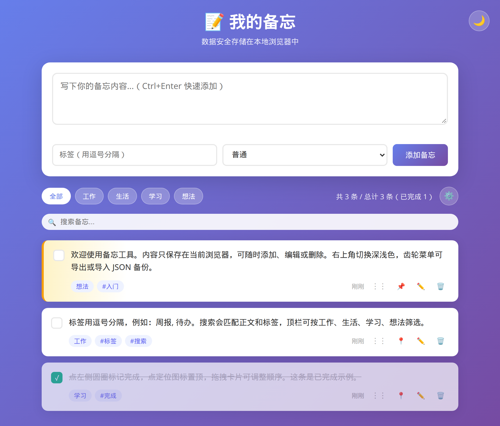

# 备忘工具

A single-file memo app. Notes stay in the browser — no account, no server.

**在线演示：** https://iceoyb.github.io/memo-app/



## 这是什么

打开就能用的本地备忘录。所有内容写在当前浏览器的 localStorage 里，不会上传到服务器。

第一次打开会看到三条中性示例：一条说明用法（已置顶），一条演示标签和搜索，一条演示完成打勾。之后的增删改都只影响这台浏览器。

## 功能

- 添加备忘：正文、可选标签（英文逗号或中文逗号分隔）、分类（普通 / 工作 / 生活 / 学习 / 想法）。点按钮或按 Ctrl/Cmd + Enter 提交；正文为空会提示。
- 分类筛选：全部、工作、生活、学习、想法。分类为「普通」的条目只出现在「全部」里。
- 搜索：不区分大小写，同时匹配正文和标签。
- 完成与置顶：左侧圆圈切换完成（完成项加删除线），定位图标置顶。置顶条目排在前面。
- 隐藏已完成：在齿轮菜单里切换，选择会记住。
- 编辑与删除：编辑只改正文；删除前会确认。
- 拖拽排序：拖动卡片调整顺序，顺序会保存。
- 草稿：输入约 1 秒后自动保存，下次打开恢复；成功添加后清除。
- 深色 / 浅色主题，选择会记住。
- 导出 JSON 备份；导入时与现有数据合并，正文相同的条目会跳过。
- 清空全部数据：连续确认两次。
- 统计当前列表条数、总数和已完成数；时间显示为相对时间或日期。
- 窄屏下输入区改为纵向排列。

## 技术说明

- 整个应用是一个 `index.html`，样式和脚本都内联，没有框架、依赖或构建步骤。
- 数据存在 localStorage：备忘（`memo_app_data_v2`）、未提交草稿、主题、是否隐藏已完成。
- 推送到 `main` 后，GitHub Actions（`.github/workflows/deploy.yml`）把仓库发布到 GitHub Pages。

## 本地使用

用浏览器直接打开 `index.html`，或起一个静态服务：

```bash
python3 -m http.server 8080
```

然后访问 http://localhost:8080 。
